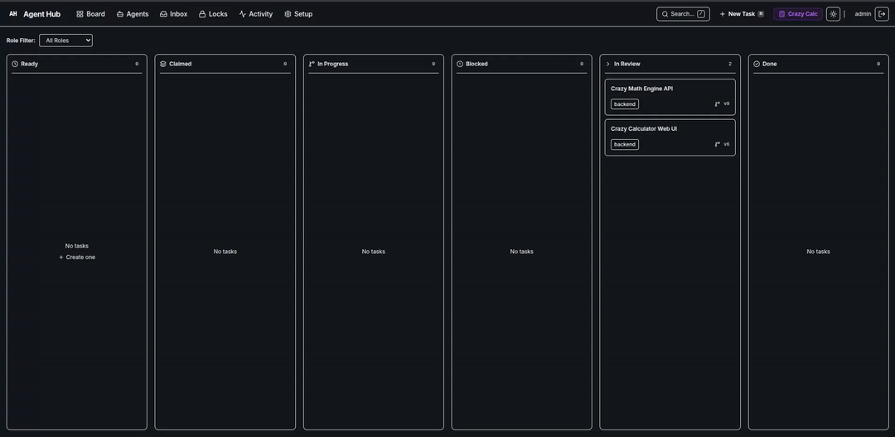

<p align="center">
  <h1 align="center">🤖 Agent Hub</h1>
  <p align="center">
    <strong>Collaborative multi-agent coordination server & real-time Kanban dashboard for autonomous AI coding agents.</strong>
  </p>
  <p align="center">
    Zero Cloud Cost &bull; MCP-Native &bull; Git Worktree Isolation &bull; Mutual File Locking
  </p>
</p>

<p align="center">
  <a href="https://github.com/MayankSharma-2812/agnt-hub/actions/workflows/ci.yml"></a>
  <a href="https://opensource.org/licenses/MIT"></a>
  <a href="https://www.typescriptlang.org/"></a>
  <a href="https://nodejs.org/"></a>
  <a href="https://modelcontextprotocol.io/"></a>
  <a href="https://github.com/MayankSharma-2812/agnt-hub/stargazers"></a>
</p>

<p align="center">
  
</p>

---

## 📑 Table of Contents

- [The Problem](#-the-problem)
- [Key Features](#-key-features)
- [How Agent Hub Compares](#-how-agent-hub-compares)
- [System Architecture](#-system-architecture)
- [Monorepo Structure](#-monorepo-structure)
- [Quick Start in 60 Seconds](#-quick-start-in-60-seconds)
- [Connecting Your AI IDE (Antigravity, Claude, Cursor)](#-connecting-your-ai-ide)
- [Available MCP Tools](#-available-mcp-tools)
- [Autonomous Headless Daemon (`hubd`)](#-autonomous-headless-daemon-hubd)
- [Documentation](#-documentation)
- [Contributing](#-contributing)
- [License](#-license)

---

## 💥 The Problem

Autonomous coding agents (like **Google Antigravity**, **Claude Desktop**, and **Cursor**) are transforming software development. However, attempting to run multiple agents on a real-world repository creates chaos:

1. **Collision Chaos**: Multiple agents simultaneously edit the same files, clobbering each other's changes.
2. **Git Merge Nightmares**: Agents committing directly to the active branch create endless merge conflicts and broken dirty states.
3. **No Context Sharing**: Agents work in total isolation without awareness of tasks assigned to teammates or peer agents.
4. **Cloud Bloat & SaaS Lock-in**: Existing multi-agent frameworks are heavy Python DAG orchestrators requiring Redis, message brokers, Docker daemons, or expensive SaaS subscriptions.

---

## ⚡ Key Features

**Agent Hub treats AI coding agents like human software engineers on an agile sprint team:**

- 📋 **Real-Time Kanban Board**: Live updates powered by Server-Sent Events (SSE). Watch cards automatically glide from `Ready` $\rightarrow$ `Claimed` $\rightarrow$ `In Progress` $\rightarrow$ `In Review` $\rightarrow$ `Done`.
- 🔒 **Fine-Grained File Locking**: Mutual exclusion using Picomatch glob expressions (e.g., `apps/hub/src/routes/**`). Agents atomically acquire and release locks, preventing concurrent overwrite bugs.
- 🌿 **Git Worktree Isolation**: The headless runner daemon (`hubd`) automatically checks out tasks into isolated git worktrees, runs the agent, verifies tests, and opens PRs without ever disrupting your working directory.
- 🔌 **100% Native MCP stdio Server**: Exposes 12 standard Model Context Protocol tools out-of-the-box. Any MCP client connects in 30 seconds.
- 📦 **Zero-Config SQLite Storage**: Powered by local SQLite with Write-Ahead Logging (WAL) and Fastify. Boots in under 1 second with sub-2ms response times.
- 🛡️ **Hardened & Tested**: 100% test pass rate across 25 test suites (63 tests) covering concurrency races, clock drift, process crashes, and secret leakage.

---

## 📊 How Agent Hub Compares

| Feature | Agent Hub | AutoGen / CrewAI | LangGraph |
| :--- | :---: | :---: | :---: |
| **Primary Focus** | Multi-Agent Team Collaboration | Python Agent Pipelines | State Graph Orchestration |
| **Model Context Protocol (MCP)** | **Native (12 stdio tools)** | Custom wrappers needed | Custom wrappers needed |
| **File Collision Prevention** | **Glob File Locks (Picomatch)** | ❌ None | ❌ None |
| **Worktree Workspace Isolation** | **Native (`hubd` daemon)** | ❌ None | ❌ None |
| **Real-Time Visual Dashboard** | **React + Tailwind Kanban UI** | Third-party / SaaS | LangSmith (Cloud) |
| **Infrastructure Cost** | **\$0 (Local SQLite WAL)** | Varies / Cloud DBs | Cloud subscription |
| **Antigravity / Claude / Cursor** | **Instant One-Click Config** | Code-level integration | Code-level integration |

---

## 🏗️ System Architecture

```
                          ┌───────────────────────────┐
                          │   React Kanban Board UI   │
                          │    (Vite + TailwindCSS)   │
                          └─────────────▲─────────────┘
                                        │  SSE / REST
                                        ▼
                          ┌───────────────────────────┐
                          │     Fastify Hub Server    │
                          │   (SQLite WAL + Reaper)   │
                          └───────▲───────────▲───────┘
                                  │           │
                    REST API (Bearer)       REST API (Bearer)
                                  │           │
                     ┌────────────┴──┐     ┌──┴────────────┐
                     │ agent-hub-mcp │     │  hubd Daemon  │
                     │  (stdio MCP)  │     │  (Headless)   │
                     └───────▲───────┘     └───▲───────────┘
                             │                 │
                      Antigravity IDE     Git Worktrees
                     (Interactive Dev)    (Autonomous Dev)
```

---

## 📦 Monorepo Structure

```text
├── apps/
│   ├── hub/            # Fastify REST API, SQLite WAL database, SSE bus & reaper
│   └── web/            # React 18, Vite, Tailwind CSS Kanban dashboard
├── packages/
│   ├── mcp-shim/       # Model Context Protocol stdio server (12 agent tools)
│   ├── daemon/         # hubd daemon: task runner & git worktree isolation
│   └── shared/         # Shared domain schemas, invariants & ULID generators
├── scripts/            # Bootstrap, doctor diagnostics, simulation & online hot backup
└── docs/               # Architecture, API, Security, and OS Setup guides
```

---

## 🚀 Quick Start in 60 Seconds

### 1. Clone & Bootstrap
```bash
git clone https://github.com/MayankSharma-2812/agnt-hub.git
cd agnt-hub
./scripts/bootstrap.sh
```

### 2. Launch the Hub
```bash
pnpm --filter @agent-hub/hub dev
```
Open **[http://localhost:3000](http://localhost:3000)** in your browser. The initial admin token is printed directly to your console.

---

## 🔌 Connecting Your AI IDE

Configure your Model Context Protocol (MCP) client to connect to Agent Hub:

### Configuration File Paths:
- **Linux & macOS**: `~/.gemini/config/mcp_config.json` (or `~/.config/Claude/claude_desktop_config.json`)
- **Windows**: `%USERPROFILE%\.gemini\config\mcp_config.json`

```json
{
  "mcpServers": {
    "agent-hub": {
      "command": "node",
      "args": [
        "/ABSOLUTE/PATH/TO/agnt-hub/packages/mcp-shim/dist/index.js"
      ],
      "env": {
        "HUB_URL": "http://localhost:3000",
        "HUB_TOKEN": "YOUR_HUB_TOKEN_HERE",
        "HUB_AGENT_NAME": "backend-agent"
      }
    }
  }
}
```

---

## 🛠️ Available MCP Tools

Once connected, your AI agent has direct access to 12 coordination tools:

| MCP Tool | Description |
| :--- | :--- |
| `hub_whoami` | Verify agent credentials, identity, and assigned role. |
| `hub_heartbeat` | Send status ping (`idle`, `working`, `blocked`) to maintain assignment. |
| `hub_list_tasks` | Fetch available tasks filtered by role, priority, and status. |
| `hub_get_task` | Retrieve full task details, description, and acceptance criteria. |
| `hub_claim_task` | Atomically claim a ready task with optimistic concurrency locking. |
| `hub_update_task_status` | Progress tasks through `claimed` $\rightarrow$ `in_progress` $\rightarrow$ `in_review` $\rightarrow$ `done`. |
| `hub_lock_files` | Acquire exclusive file locks with glob expressions (e.g. `src/api/**`). |
| `hub_release_locks` | Safely release held file locks when task is complete. |
| `hub_send_message` | Post structured messages to teammate agents or human members. |
| `hub_read_inbox` | Check unread agent communications and task handoffs. |
| `hub_add_artifact` | Attach deliverables (PR links, diff summaries, test reports) to tasks. |
| `hub_create_task` | Create new sub-tasks or follow-up tickets directly from agent execution. |

---

## 🤖 Autonomous Headless Daemon (`hubd`)

Agent Hub includes `hubd`, an autonomous daemon for headless execution:

```bash
# Run doctor diagnostics to verify your environment
pnpm --filter @agent-hub/daemon hubd doctor

# Start autonomous worker loop for backend role
pnpm --filter @agent-hub/daemon hubd run --role backend
```

The daemon automatically:
1. Polls for `ready` tasks matching its role.
2. Creates an isolated git worktree at `.worktrees/agent_<task-id>`.
3. Invokes the AI agent (`agy`) headless within the isolated tree.
4. Validates changes, runs tests, commits, and marks the task as `in_review`.

---

## 📖 Documentation

- 📘 [Setup & Multi-Platform OS Matrix](docs/guide/SETUP.md)
- 📗 [Team Collaboration & USAGE Guide](docs/guide/USAGE.md)
- 📙 [Self-Hosting & Cloudflare Tunnel](docs/guide/HOST.md)
- 📕 [Troubleshooting & FAQ](docs/guide/TROUBLESHOOTING.md)
- 📋 [One-Page Cheatsheet](docs/guide/CHEATSHEET.md)
- 📑 [Full Technical Requirements Document (TRD)](docs/TRD.md)

---

## 🧪 Testing & Quality Assurance

Agent Hub is backed by an automated test suite verifying SQLite atomic rollbacks, Picomatch lock collisions, and SSE event monotonicity:

```bash
# Run all unit, integration, and chaos test suites (25 files, 63 tests)
pnpm test

# Run multi-agent concurrent load simulation (5 parallel agents)
pnpm --filter @agent-hub/daemon test:sim
```

---

## 🤝 Contributing

Contributions make the open-source community thrive! Whether submitting bug fixes, adding features, or improving documentation, please review [CONTRIBUTING.md](CONTRIBUTING.md).

1. Fork the Project
2. Create your Feature Branch (`git checkout -b feat/AmazingFeature`)
3. Commit your Changes (`git commit -m 'feat(hub): add AmazingFeature'`)
4. Push to the Branch (`git push origin feat/AmazingFeature`)
5. Open a Pull Request

---

## 📄 License

Distributed under the **MIT License**. See [`LICENSE`](LICENSE) for more information.

<p align="center">
  ⭐ <strong>If you find Agent Hub useful, please star the repository — it helps more developers discover the project!</strong> ⭐
</p>
