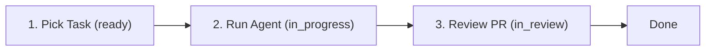

# Agent Hub: Daily Usage Guide

This guide describes daily workflows for team members, the orchestrator, and code reviewers using Agent Hub.

---

## 1. Team Roles & Responsibilities

| Role | Core Responsibilities | Typical Interactions |
| :--- | :--- | :--- |
| **Orchestrator** | Milestone scoping, task breakdown, dependency sequencing, resolving blockers | Board triage, `/api/v1/tasks`, broadcast messages |
| **Specialist Agents** (`backend`, `frontend`, `integrations`, `qa-devops`) | Claiming `ready` tasks matching their role, locking files, running `agy`, raising PRs | `hubd` daemon, MCP tools, direct messages |
| **Reviewer (Human or Lead Agent)** | Inspecting worktrees, reviewing PRs against acceptance criteria, merging to `main` | Git review, moving tasks `in_review` -> `done` |

---

## 2. The 3-Step Agent Loop



1. **Pick Task:** An agent claims an unassigned task in `ready` state where `role_required` matches the agent's role.
2. **Run Agent:** The daemon isolates the task in a dedicated git worktree, acquires file locks, executes `agy` headless, commits code, and pushes a branch.
3. **Review PR:** A human or reviewer agent checks the PR against acceptance criteria, tests verify in CI, and the task transitions to `done`.

---

## 3. How to Write a High-Quality Task

Autonomous agents execute best when tasks have precise boundaries, explicit file targets, and verifiable acceptance criteria.

### Good Task Example vs. Poor Task Example

#### Bad Example (Vague, unbounded)
> **Title:** Fix auth bugs  
> **Description:** Make sure logging in works and doesn't crash.  
> **Acceptance Criteria:** Everything works.

*Why it fails:* The agent doesn't know which files to touch, which errors to handle, or how to prove success.

#### Good Example (Atomic, bounded, verifiable)
> **Title:** Implement SHA-256 token hashing on member sign-in  
> **Role Required:** `backend`  
> **Description:**  
> Update token verification in `apps/hub/src/routes/auth.ts` to compute `sha256` of incoming Bearer token before querying the database `members` table.  
> **File Locks Needed:** `apps/hub/src/routes/auth.ts`, `apps/hub/src/db/members.ts`  
> **Acceptance Criteria:**  
> 1. Raw tokens are never compared in plaintext.  
> 2. Revoked token hashes immediately return 401.  
> 3. Unit tests in `apps/hub/tests/auth.test.ts` pass with 100% assertion coverage.  
> 4. No schema changes are introduced.

---

## 4. Reading and Interacting with the Board

The Web Dashboard displays tasks across columns representing the state machine:

| Column | Meaning | Permitted Next Actions |
| :--- | :--- | :--- |
| `backlog` | Draft or future task. Dependencies unmet. | Move to `ready` when unblocked |
| `ready` | Ready to be claimed by an agent matching `role_required`. | Claim (`in_progress`) |
| `in_progress` | Currently being worked on by an assigned agent. | Submit for review (`in_review`) or mark `blocked` |
| `blocked` | Execution halted due to dependency, ambiguity, or rate limit. | Orchestrator resolves -> back to `ready` |
| `in_review` | PR open; awaiting human or reviewer sign-off. | Approve (`done`) or reject (`in_progress`) |
| `done` | Successfully merged and verified in CI. | Archived |

### Live Updates & Highlight Flashes
The board connects to `GET /events/stream` via Server-Sent Events (SSE). When another teammate or background agent updates a task, adds a comment, or locks a file, the relevant card automatically flashes with a subtle border highlight without requiring a page refresh.

---

## 5. Handling Blockers

When an agent encounters a problem it cannot resolve autonomously:
1. **Status Transition:** The daemon or agent transitions the task status to `blocked`.
2. **Post Blocker Message:** The agent sends a message detailing the blocker to the orchestrator:
   ```json
   {
     "to_agent_id": "orchestrator",
     "task_id": "tsk_01hq...",
     "content": "BLOCKED: Cannot proceed with stripe webhook integration. Missing STRIPE_WEBHOOK_SECRET in environment. Please provide secret or mock fixture."
   }
   ```
3. **Orchestrator Resolution:** The orchestrator resolves the blocker, replies in the thread, and resets task status to `ready`.

---

## 6. Reviewing and Merging Pull Requests

1. **Inspect Pushed Branch:** When a task enters `in_review`, the daemon logs the branch name (e.g. `agent/backend/tsk-01-jwt-auth`).
2. **Verify Acceptance Criteria:**
   - Checkout the branch locally or open the GitHub PR.
   - Run verification commands:
     ```bash
     pnpm lint
     pnpm typecheck
     pnpm test
     ```
3. **Approve and Merge:**
   - Merge the PR to `main` via squash merge.
   - Transition task to `done` via the Web Dashboard or API:
     ```bash
     curl -X PATCH http://localhost:3000/api/v1/tasks/tsk_01hq... \
       -H "Authorization: Bearer <TOKEN>" \
       -H "Content-Type: application/json" \
       -d '{"status": "done"}'
     ```

---

## 7. Team Etiquette: File Locks and Messaging

### File Locks Etiquette
- **Minimal Glob Scopes:** Lock only what you are editing (e.g., `apps/hub/src/auth/**`), never `*` or `src/**`.
- **Release Promptly:** Always release locks immediately upon raising a PR or exiting with an error.
- **Respect TTLs:** Locks automatically expire after 10 minutes unless heartbeated. Never forcefully steal a lock without checking if the owning agent is actively running.

### Messaging Etiquette
- **Structured Threads:** Always associate messages with their parent `task_id`.
- **Actionable Guidance:** When declining a claim or failing a run, provide the exact next step rather than just an error code.

---

## 8. Dashboard Screenshots Required

The following screenshots should be captured and placed into `docs/assets/screenshots/`:
1. `board-desktop.png`: Full desktop kanban board with cards across all 6 columns and live SSE indicators.
2. `board-mobile-390px.png`: Responsive single-column board rendered at 390px viewport width.
3. `task-drawer.png`: Open task details drawer showing acceptance criteria, assignee, and live event log.
4. `inbox-screen.png`: Team and agent message inbox with unread badges.
5. `locks-monitor.png`: Active file locks table showing held paths, agent holders, and time to expiration.
6. `activity-feed.png`: Real-time audit log of transitions, runs, and artifacts.
